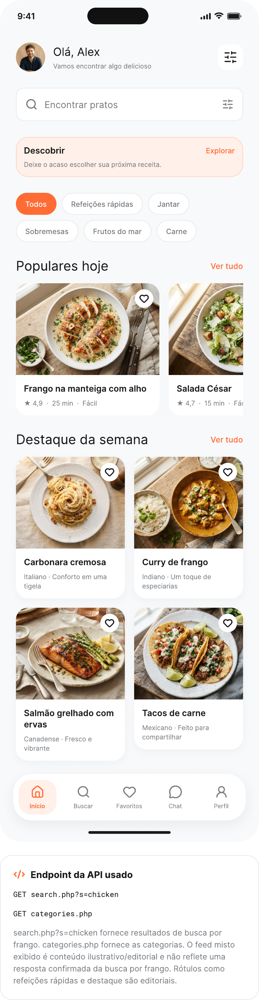
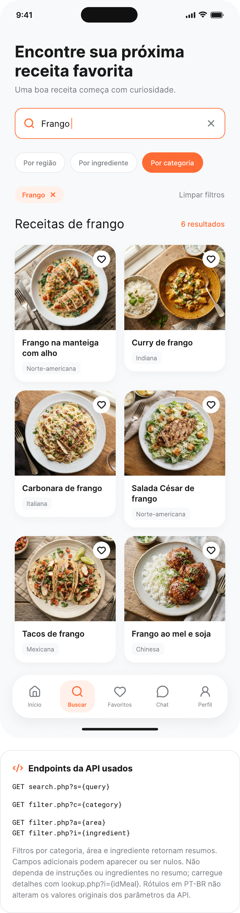

# MealFinder

Aplicativo acadêmico em Flutter para descobrir receitas internacionais. O MealFinder consulta a [TheMealDB](https://www.themealdb.com/api.php), permite buscar, filtrar, sortear uma receita e guardar favoritos apenas no dispositivo.

## Telas

| Início | Buscar | Favoritos | Descobrir | Perfil |
| --- | --- | --- | --- | --- |
| Saudação, categorias, carrossel e destaques | Busca por nome e filtros | Coleção persistida localmente | Receita aleatória | Preferências locais |

A interface foi construída a partir dos wireframes fornecidos: fundo claro, cartões brancos com cantos arredondados, cor de destaque `#FF6B35` e barra de navegação flutuante.

## Referência visual

Os sete wireframes originais continuam versionados em [`tmp/pdfs`](tmp/pdfs). Eles documentam as telas de Início, Busca, Favoritos, Descobrir, Perfil, Detalhes e as decisões técnicas que nortearam a implementação.

| Início | Buscar | Detalhes |
| --- | --- | --- |
|  |  |  |

## Tecnologias

- Flutter e Dart
- [Provider](https://pub.dev/packages/provider) para estado
- [http](https://pub.dev/packages/http) para a TheMealDB
- [shared_preferences](https://pub.dev/packages/shared_preferences) para IDs favoritos locais
- [cached_network_image](https://pub.dev/packages/cached_network_image) para imagens
- [url_launcher](https://pub.dev/packages/url_launcher) para tutoriais em vídeo

## TheMealDB: tela x endpoint

| Tela/ação | Endpoint |
| --- | --- |
| Início - pratos de frango e categorias | `search.php?s=chicken`, `categories.php` |
| Detalhes | `lookup.php?i={idMeal}` |
| Buscar por nome | `search.php?s={nome}` |
| Buscar por categoria | `filter.php?c={categoria}`, `list.php?c=list` |
| Buscar por região | `filter.php?a={região}`, `list.php?a=list` |
| Buscar por ingrediente | `filter.php?i={ingrediente}`, `list.php?i=list` |
| Descobrir | `random.php` |
| Favoritos | IDs locais + `lookup.php?i={idMeal}` |
| Perfil e Chat | Sem endpoint |

Todos os endpoints acima usam a base `https://www.themealdb.com/api/json/v1/1/` e foram validados com HTTP 200 durante a implementação. A aplicação trata respostas com `meals: null`, timeout, problemas de rede, JSON inválido e imagens indisponíveis.

## Dados da API x editoriais

TheMealDB fornece título, imagem, categoria, região, ingredientes, medidas, instruções e, quando disponível, URL do vídeo. Ela não fornece nota, duração, dificuldade, porções, descrição curta ou favoritos.

Por isso, nota, duração, dificuldade e porções são dados editoriais locais e determinísticos, calculados a partir do `idMeal`: a mesma receita mantém os mesmos valores entre aberturas. A descrição curta também é editorial. Favoritos guardam somente os IDs no dispositivo e são hidratados com `lookup.php` quando a aba é aberta.

Os filtros editoriais da Home preservam o valor em inglês enviado à API:

| Rótulo exibido | Categoria enviada |
| --- | --- |
| Refeições rápidas | `Chicken` |
| Jantar | `Beef` |
| Sobremesas | `Dessert` |
| Frutos do mar | `Seafood` |
| Carne | `Beef` |

O app traduz rótulos de interface comuns para PT-BR, mas nunca traduz os parâmetros enviados para a API. A busca também reconhece termos comuns como `frango` e consulta `chicken`.

## Como executar

1. Instale o Flutter estável e entre na pasta do projeto.
2. Execute `flutter pub get`.
3. Execute `flutter run` e selecione um emulador, dispositivo ou Chrome.
4. Para validar a qualidade, execute `flutter analyze` e `flutter test`.

No Android, a permissão `INTERNET` já está declarada no manifesto principal.

## Estrutura

```text
lib/
├── models/       # summaries, detalhes, categorias e dados editoriais
├── screens/      # Home, Busca, Detalhes, Favoritos, Descobrir, Perfil e Chat
├── services/     # TheMealDB e persistência local de favoritos
├── theme/        # tokens visuais centralizados
└── widgets/      # cards, estados assíncronos e navegação reutilizável
```

## Testes

Há um teste de parsing de `MealDetail` que cobre o pareamento de ingredientes e medidas, valores nulos/vazios e a separação de etapas de preparo.
